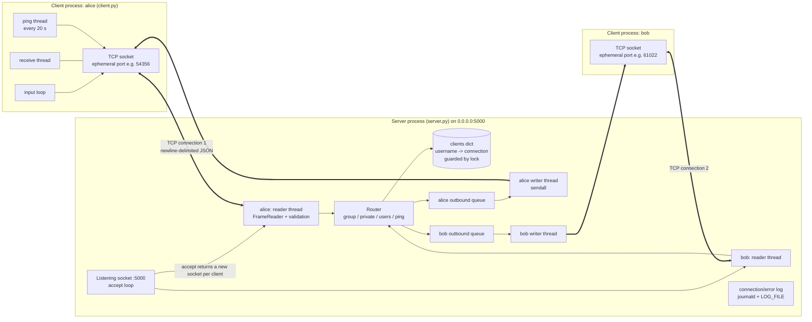
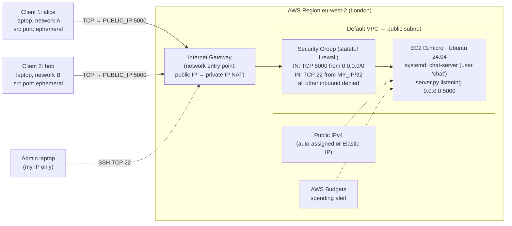

# TCP Chat (CSC 423)

A multi-user, real-time chat application built directly on TCP sockets in Python. It uses only the standard library: no frameworks and no `pip install`.

- Group chat and private (one-to-one) messages
- Unique usernames (case-insensitive)
- Newline-delimited JSON protocol with proper framing over the TCP byte stream
- Detects graceful leaves, crashed clients, idle/dead connections and server shutdown
- Per-client outbound queues, so one slow client cannot hold up the others
- Input validation, message size limits, rate limiting and a server-side connection/error log
- 25 automated tests over real sockets
- Tools for the four TCP investigations and a separate TCP vs UDP comparison ([docs/EXPERIMENTS.md](docs/EXPERIMENTS.md))

## Project layout

| File | Purpose |
|---|---|
| `protocol.py` | Message encoding and framing (shared by server, client and tests) |
| `server.py` | Multi-client TCP server |
| `client.py` | Terminal chat client |
| `tests/test_chat.py` | Automated tests |
| `experiments/compare_tcp_udp.py` | TCP vs UDP comparison: numbered messages, loss/order/latency (separate from the chat) |
| `experiments/tcp_bench.py` | RTT, throughput, slow-receiver flow control, RST abort, split-message framing demo |
| `experiments/netem.sh` | Controlled loss/delay on loopback with `tc netem` |
| `docs/EXPERIMENTS.md` | Step-by-step guide for the 4 TCP experiments and the comparison |
| `docs/TEST_LOG.md` | Test log: automated results + manual cloud tests to fill in |
| `captures/` | Packet captures (`.pcap`/`.pcapng`) for submission |
| `results/` | Experiment output (CSV) and saved test output |
| `deploy/` | systemd service and VM setup script |
| `.env.example` | Configuration template (copy to `.env`) |

## Application architecture



Each TCP connection is identified by its 4-tuple (client IP, client port, server IP, 5000). The server's listening socket stays on port 5000. `accept()` returns a new connected socket for every client, and that socket is served by its own reader and writer threads.

## Run locally

Requires Python 3.9 or newer.

```bash
# terminal 1
python server.py --port 5000

# terminal 2
python client.py --host 127.0.0.1 --port 5000 --username alice

# terminal 3
python client.py --host 127.0.0.1 --port 5000 --username bob
```

Chat commands:

| Input | Action |
|---|---|
| `hello everyone` | Send to everyone |
| `/msg bob hi` | Private message to bob |
| `/users` | List online users |
| `/help` | Show commands |
| `/quit` | Leave the chat |

Run the tests (and save the output for the test log):

```bash
python -m unittest discover -s tests -v 2>&1 | tee results/test_log_automated.txt
```

## Working from Windows

You don't need Linux on your laptop. The Linux parts (the server, `tcpdump`, `tc netem`) run on the Ubuntu EC2 VM, which you control from Windows PowerShell over SSH.

| Where | What runs there |
|---|---|
| Windows laptop | `client.py`, Wireshark (Experiment 1), `tcp_bench.py rtt/abort/split` against the cloud server, the automated tests |
| EC2 VM (via `ssh`) | `server.py` service, `tcpdump`, `netem.sh`, `compare_tcp_udp.py`, Experiments 2 and 4 |

**One-time setup on Windows**
1. Install **Python 3.12+** from python.org. Tick **"Add python.exe to PATH"**. Check with `python --version` in PowerShell.
2. Install **Wireshark** from wireshark.org. Accept the bundled **Npcap** installer, which lets it capture traffic.
3. `ssh` and `scp` are built into Windows 10/11. Check with `ssh -V`.
4. Unzip the project, open the folder in File Explorer, then Shift + right-click → "Open PowerShell window here" (or open the folder in VS Code's terminal).

**Fix the key-file permissions** (otherwise `ssh` refuses with "UNPROTECTED PRIVATE KEY FILE"):
```powershell
icacls .\key.pem /inheritance:r
icacls .\key.pem /grant:r "$($env:USERNAME):(R)"
```

**Windows equivalents of the Linux commands in these docs**

| Linux command in the docs | On Windows PowerShell |
|---|---|
| `python3 ...` | `python ...` |
| `... \| tee results/test_log_automated.txt` | `python -m unittest discover -s tests -v 2>&1 \| Tee-Object results\test_log_automated.txt` |
| `scp -i key.pem -r tcp-chat ubuntu@<IP>:~` | Same command; run it from the folder that *contains* `tcp-chat` |
| Download captures | `scp -i .\key.pem "ubuntu@<IP>:~/tcp-chat/captures/*" .\captures\` |
| `nc -vz <IP> 5000` | `Test-NetConnection <IP> -Port 5000` (look at `TcpTestSucceeded`) |
| `printf ... \| nc <IP> 5000` (framing demo) | `python experiments\tcp_bench.py split --host <IP> --port 5000` |
| `kill -9 <pid>` (abrupt client exit) | Close the client's PowerShell window, or Task Manager → End task |
| `sudo ...` commands | Run them **inside the SSH session** on the VM, not on Windows |

When you run `server.py` locally on Windows for testing, Windows Defender Firewall may ask for permission. "Private networks" is enough. Clients on the same machine work either way.

Optional: if you want Linux tools on the laptop itself, WSL2 (`wsl --install` in an admin PowerShell) gives you an Ubuntu terminal. It isn't needed for this project.

## Message protocol

Every message is one JSON object followed by a newline (`\n`). TCP delivers a stream of bytes with no message boundaries, so the newline marks where each message ends. `json.dumps` escapes newlines inside text as `\n`, so a raw newline byte can only mean "end of message".

**Client → server**

| type | fields | meaning |
|---|---|---|
| `join` | `username` | Must be the first message |
| `message` | `text` | Group message |
| `private` | `to`, `text` | One-to-one message |
| `users` | – | Ask for the online list |
| `ping` | – | Keep-alive (sent every 20 s) |
| `leave` | – | Graceful exit |

**Server → client**

| type | fields | meaning |
|---|---|---|
| `join_ok` | `username`, `users`, `ts` | Join accepted |
| `message` | `from`, `text`, `ts` | Group message |
| `private` | `from`, `to`, `text`, `ts` | Private message (also echoed to the sender) |
| `system` | `event` (`join`/`leave`/`shutdown`), `username`, `reason`, `text`, `ts` | Presence and server notices |
| `user_list` | `users` | Reply to `users` |
| `pong` | `ts` | Reply to `ping` |
| `error` | `code`, `text` | e.g. `username_taken`, `no_such_user`, `rate_limited`, `bad_message` |

Example exchange:

```
C→S {"type":"join","username":"alice"}
S→C {"type":"join_ok","username":"alice","users":["alice","bob"],"ts":"2026-11-10T09:50:23+00:00"}
C→S {"type":"message","text":"hello bob"}
S→* {"type":"message","from":"alice","text":"hello bob","ts":"2026-11-10T09:50:24+00:00"}
```

## How disconnections are handled

| Situation | What TCP does | How the server notices | Result |
|---|---|---|---|
| User types `/quit` | Client sends `leave`, then FIN | `leave` message | Others see "alice left the chat" |
| Client process killed | OS sends FIN (or RST) for the socket | `recv()` returns `b""` or raises `ConnectionResetError` | "alice disconnected (connection closed / reset)" |
| Wi-Fi drops / laptop sleeps | Nothing is sent | No data for 60 s (`IDLE_TIMEOUT`); TCP keepalive probes as a backup | "alice disconnected (timed out)" |
| Server stops (`systemctl stop`) | Server sends a `shutdown` notice, then FIN to every client | Client `recv()` returns `b""` | Client prints "Disconnected from server" |

## Cloud deployment (AWS EC2)

### Architecture



The TCP path is: client socket (laptop IP : ephemeral port) → home/mobile NAT → internet → AWS Internet Gateway (public IP translated to the instance's private IP) → security group check (port 5000 allowed) → EC2 network interface → kernel TCP stack → `server.py` listening socket.

### Services used

| Service | Why |
|---|---|
| **EC2** (t3.micro) | A Linux VM that runs the Python server 24/7. A raw TCP server needs a machine with an open port, which a VM gives directly. Serverless/HTTP-only platforms (Lambda, App Engine standard) don't accept arbitrary TCP connections. |
| **Security group** | Stateful firewall: opens TCP 5000 to everyone and SSH 22 only to your IP. Replies to allowed connections are let out automatically. |
| **Public IPv4 / Elastic IP** (optional) | The address clients connect to. An Elastic IP stays the same across stop/start. |
| **VPC + Internet Gateway** (default) | Network entry point; gives the instance a route to the internet |
| **AWS Budgets** | Emails you before spending goes over a set amount |
| **systemd** (on the VM) | Keeps the server running, restarts it on failure, starts it on boot |

Why AWS EC2: free-tier/credit eligible, full control of the OS (needed for `tcpdump` and `tc netem` in the experiments), and a plain public IP and port, which suits a raw TCP service.

### Before you deploy: cost check

AWS changed its free tier on 15 July 2025. Check which one your account has: Billing and Cost Management → Free Tier (or Credits).

| Account type | What's free |
|---|---|
| Created **before** 15 July 2025 (legacy free tier, first 12 months) | 750 hours/month of t2.micro or t3.micro, plus 750 hours/month of public IPv4 on EC2 |
| Created **on or after** 15 July 2025 ("Free plan") | $100 credit at sign-up (up to $200 by completing activities), valid for 6 months. Usage is deducted from the credits. |

**Estimated cost of this deployment** (one t3.micro, 8 GB gp3 disk, one public IPv4, very little traffic). Approximate on-demand prices; check the AWS Pricing Calculator for your region:

| Item | Approx. rate | 2 weeks (assignment window) | Full month |
|---|---|---|---|
| t3.micro | ~$0.010–0.014 / hour | ~$4 | ~$8–10 |
| Public IPv4 | $0.005 / hour | ~$1.70 | ~$3.60 |
| EBS gp3 8 GB | ~$0.08–0.10 / GB-month | ~$0.40 | ~$0.80 |
| Data transfer | Chat text is tiny | ~$0 | ~$0 |
| **Total** | | **≈ $6** | **≈ $12–15** |

On a legacy free-tier account within its first 12 months, this should be $0. On the new Free plan it comes out of the sign-up credits. **Statement for the report:** "Expected cost: $0 out of pocket (covered by free tier/credits); worst case about $6 for the two-week assessment period if credits did not apply. A $5 budget alert was configured."

**Set a spending alert first:** Billing and Cost Management → Budgets → Create budget → "Zero spend budget" or a monthly cost budget of $5 → add your email.

### Steps

1. **Launch the instance.** EC2 → Launch instance → name `tcp-chat` → Ubuntu Server 24.04 LTS → **t3.micro** (shown as "Free tier eligible") → create a key pair (keep the `.pem` file private; it is git-ignored). Region: eu-west-2 (London) gives lower latency from Nigeria than the US regions. af-south-1 (Cape Town) is closer but costs more and must be enabled first.
2. **Security group inbound rules** (only these two):
   - SSH, TCP 22, source **My IP** (not 0.0.0.0/0)
   - Custom TCP, port 5000, source `0.0.0.0/0`
   No UDP ports are needed: the UDP comparison runs on the VM's loopback interface.
3. (Optional) **Elastic IP:** EC2 → Elastic IPs → Allocate → Associate with the instance. Release it during cleanup: an unattached Elastic IP is still charged.
4. **Copy the code and install the service:**
   ```bash
   scp -i key.pem -r tcp-chat ubuntu@<PUBLIC_IP>:~
   ssh -i key.pem ubuntu@<PUBLIC_IP>
   cd tcp-chat && sudo bash deploy/setup_vm.sh
   ```
   Or `git clone` the repository on the VM instead of using `scp`.
5. **Check it is running:**
   ```bash
   sudo systemctl status chat-server
   sudo journalctl -u chat-server -f     # live log of connections
   ```
6. **Connect from two different machines:**
   ```bash
   python client.py --host <PUBLIC_IP> --port 5000 --username alice
   ```

**Connection details:** `<PUBLIC_IP>:5000` (TCP). Fill this in after deploying.

### Same thing on GCP (alternative)

```bash
gcloud compute instances create tcp-chat --machine-type=e2-micro --zone=us-central1-a \
  --image-family=ubuntu-2404-lts-amd64 --image-project=ubuntu-os-cloud --tags=chat-server
gcloud compute firewall-rules create allow-chat-5000 --allow=tcp:5000 --target-tags=chat-server
gcloud compute scp --recurse tcp-chat tcp-chat:~ --zone=us-central1-a
gcloud compute ssh tcp-chat --zone=us-central1-a --command "cd tcp-chat && sudo bash deploy/setup_vm.sh"
```
GCP notes:
- The e2-micro is in the Always Free tier only in us-west1, us-central1 and us-east1.
- The default network's `default-allow-ssh` rule allows SSH from anywhere. Edit it to your own IP (`--source-ranges=<MY_IP>/32`).
- Set a budget alert under Billing → Budgets & alerts.

### Start, restart and shut down

```bash
sudo systemctl start chat-server       # start
sudo systemctl restart chat-server     # restart (clients get a shutdown notice, then reconnect)
sudo systemctl stop chat-server        # stop (SIGTERM → clients notified → sockets closed)
sudo systemctl status chat-server      # check
sudo journalctl -u chat-server -f      # follow the connection/error log
```
The service starts automatically on boot. Stopping the EC2 instance stops compute charges, but the disk and any Elastic IP are still billed.

### Safe cleanup (after grading)

Do this in order, so nothing keeps billing:
1. Download anything you need: captures, logs, `results/`.
2. EC2 → Instances → select `tcp-chat` → **Terminate**. This deletes the root EBS volume by default; check under Volumes that nothing is left.
3. EC2 → Elastic IPs → **Release** (if you allocated one).
4. EC2 → Security Groups → delete the `tcp-chat` group. EC2 → Key Pairs → delete the key pair, and delete the local `.pem` file.
5. Check Billing → Bills a day later for any remaining line items. Keep the budget alert.

GCP: `gcloud compute instances delete tcp-chat --zone=us-central1-a` and `gcloud compute firewall-rules delete allow-chat-5000`.

## Demo preparation (live verification)

The lecturer may ask for live changes. Practise these:

**Change the listening port live** (e.g. to 6001):
```bash
sudo sed -i 's/^CHAT_PORT=.*/CHAT_PORT=6001/' /opt/tcp-chat/.env
sudo systemctl restart chat-server
sudo ss -ltnp | grep python            # confirm LISTEN on 0.0.0.0:6001
```
Then add an inbound rule for TCP 6001 to the security group (and remove 5000). Clients connect with `--port 6001`. If you skip the security-group step the client times out, which is itself a good demonstration.

**Diagnose a failed connection**, working outwards from the server:
| Check | Command | What it tells you |
|---|---|---|
| Is the process running? | `systemctl status chat-server` | Crashed or stopped |
| Is it listening, on which address/port? | `sudo ss -ltnp` | `127.0.0.1:5000` = only local clients can reach it; it should be `0.0.0.0:5000` |
| Local connect works? | `nc -vz 127.0.0.1 5000` (on the VM) | Rules out the app |
| OS firewall? | `sudo ufw status` | Port blocked inside the VM |
| Cloud firewall? | Security group inbound rules | Missing rule → client **times out** (SYN dropped silently) |
| Remote connect? | Windows: `Test-NetConnection <PUBLIC_IP> -Port 5000` (Linux/macOS: `nc -vz <PUBLIC_IP> 5000`) | "Connection refused" = packet reached the host, nothing listening (RST). "Timed out" = blocked on the way (firewall) |
| Right IP? | EC2 console | Public IP changes after stop/start unless you use an Elastic IP |
| What's on the wire? | `sudo tcpdump -ni any tcp port 5000` | SYN arriving with no SYN-ACK = app not listening; no SYN at all = blocked before the VM |

**Show framing live:** `python experiments\tcp_bench.py split --host <PUBLIC_IP> --port 5000`. It sends a join message in two halves with a 2-second gap. The server answers only after the newline arrives, then rejects a malformed line without crashing.

## Collecting evidence for the report

The submission needs: screenshots/recording of concurrent users, `.pcap` files and annotated screenshots for the four TCP experiments, the TCP/UDP comparison table with raw results, and a test log.

1. **Two or more users at once:** run the client on two different machines (e.g. your laptop on Wi-Fi and a groupmate's laptop on mobile data). Screenshot both terminals side by side, showing a group message and a private message. A short screen recording is better.
2. **Server log:** screenshot `journalctl -u chat-server -f` showing both clients' public IPs and ports joining and leaving.
3. **The four TCP experiments and the TCP vs UDP comparison:** follow [docs/EXPERIMENTS.md](docs/EXPERIMENTS.md). Save captures in `captures/` and results in `results/`.
4. **Test log:** run the automated tests and fill in the manual cloud tests in [docs/TEST_LOG.md](docs/TEST_LOG.md).

Packet captures are **committed** (in `captures/`) because the brief requires them. Before committing, open each one and check it contains only test chat text: no passwords, tokens or personal messages. SSH traffic is encrypted, but capture with a port filter (`tcp port 5000`) anyway so it isn't included.

## Security

| Area | What's done |
|---|---|
| Exposed ports | Only TCP 5000 (chat) is open to the internet. SSH 22 is open only to the admin's IP. Everything else is denied by the security group. |
| Secrets | No credentials in code or Git. Settings come from environment variables (`.env`, loaded by systemd's `EnvironmentFile`). `.env`, `.pem` and `.key` files are git-ignored, and `.env.example` holds only non-secret defaults. The app has no API keys or database passwords. |
| Process isolation | Runs as an unprivileged `chat` user; systemd hardening (`ProtectSystem=strict`, `NoNewPrivileges`, etc.) |
| Input handling | Size limits, JSON/type validation, username rules, rate limiting, join timeout, max-client cap |
| Logging | Connections, joins, rejections, malformed input and disconnect reasons, with client IP:port (journald, optionally `LOG_FILE`) |

**TLS: not used, and why.** Chat traffic is plain TCP, so anyone on the path can read it (Experiment 1's "Follow TCP Stream" shows this). TLS was left out because:
- The assignment is about observing TCP. With TLS, the captures would show only encrypted records, and the framing and JSON couldn't be shown.
- A certificate for a bare IP address isn't practical on the free tier.

Mitigations: only test content is used, and there are no accounts or passwords. For real use, wrap the socket with `ssl.SSLContext.wrap_socket()` on both sides (TLS over TCP, usually on port 443 or 5001) with a certificate for a domain name. This is listed as future work.

## Limitations and future work

- TLS encryption (see Security)
- Accounts and passwords (currently usernames only)
- Message history (messages are not stored once delivered)
- No end-to-end delivery receipts. TCP confirms bytes reached the server's kernel, not that the other user read them. Messages sent while a user is disconnected are not queued for them, and a client can't tell whether its last message got through when a connection fails.
- Single server. If the VM goes down, the chat goes down (no load balancer or failover).
- Browser UI through a WebSocket gateway. WebSocket starts as an HTTP request, upgrades the same TCP connection and then sends framed messages over it, so it is a message protocol built on TCP.
- One thread pair per client is fine for a class-sized chat. For thousands of users, `asyncio`/`selectors` (an event loop with non-blocking sockets) would scale better.
